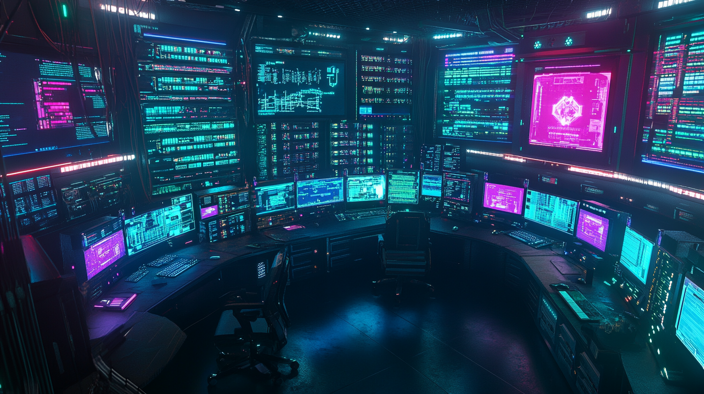
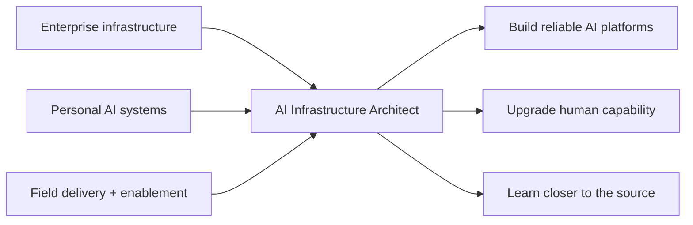
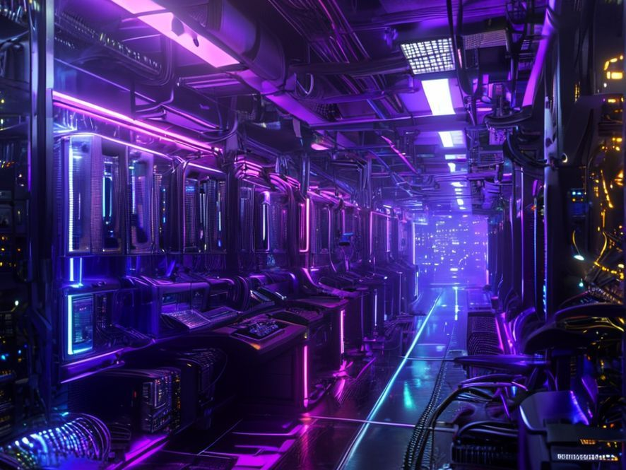
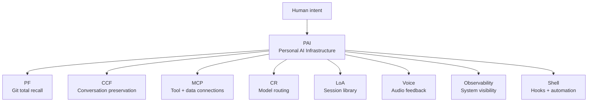
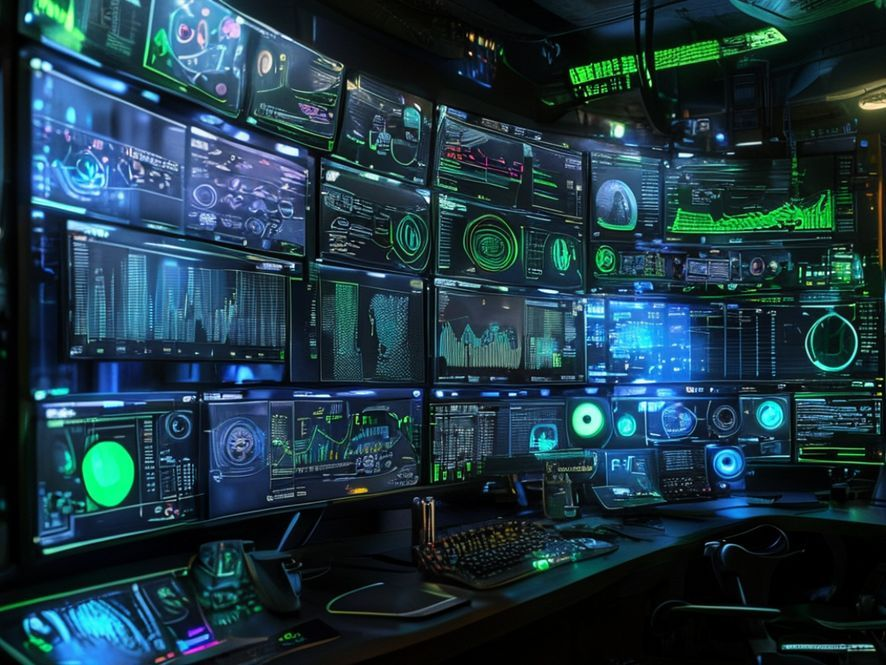
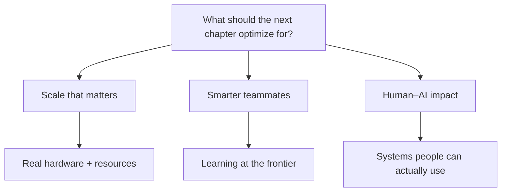
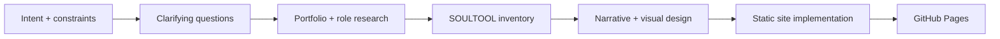

<p align="center">
  <a href="https://nixfred.com/nextstep/">
    
  </a>
</p>

<h1 align="center">THE NEXT CHAPTER</h1>

<p align="center">
  <strong>AI infrastructure. Personal AI. Human capability.</strong><br>
  A public calling card for the work—and the team—worth building next.
</p>

<p align="center">
  <a href="https://nixfred.com/nextstep/"><strong>Enter the war room</strong></a>
  ·
  <a href="https://nixfred.com/ai/">AI infrastructure</a>
  ·
  <a href="https://nixfred.com/resume/">Résumé</a>
</p>

## The mission

`nextstep` brings three threads together: enterprise infrastructure experience, hands-on AI systems, and a conviction that personal AI should make people more capable. It describes the next role as a place close to the source of AI innovation—with serious hardware, real resources, strong collaborators, and meaningful human impact.

> **1000% confidence with humility.** Know what has been built. Know what remains unknown. Keep moving toward it.



<p align="center">
  
  
</p>

<p align="center"><sub>Illustrative portfolio artwork expressing the mission and scale—not documentary photography of a specific facility.</sub></p>

## The system behind the story

The site presents **SOULTOOLs**, a nine-part personal AI infrastructure assembled around continuity, context, routing, durable memory, voice, observability, and automation.



| Component | Role in the system |
| --- | --- |
| **PF — pi_forever** | Git-backed recall and continuity across work. |
| **PAI** | The organizing layer for skills, hooks, context, and memory. |
| **CCF** | Preservation of AI-assisted development conversations. |
| **MCP** | Connections between models, tools, and external systems. |
| **CR — Claude Router** | Intelligent routing across available models. |
| **LoA — Library of Alexandria** | Dated sessions, decisions, next steps, and transcripts. |
| **Voice** | Spoken notifications and feedback. |
| **Observability** | Real-time visibility into the system and its activity. |
| **Shell** | The automation fabric underneath the experience. |

<p align="center">
  
  
</p>

## What the war room communicates



The public page combines:

- a concise statement of direction;
- the complete SOULTOOL inventory;
- the AI, infrastructure, development, and observability stack;
- gratitude to the open-source people and projects that shaped the work;
- direct paths to the deeper AI portfolio and résumé.

<p align="center">
  
  
</p>

## How it was built

The site began as one detailed conversation with Larry, Fred's personal AI infrastructure. The request combined the existing résumé, AI portfolio, and Larry story into a single technical calling card. The resulting workflow moved from questions and research to system inventory, narrative design, implementation, and public deployment.



## Repository shape

This is a deliberately lightweight static site. There is no framework, package installation, compilation step, runtime API, or database.

```text
.
├── index.html        # Complete page: markup, styles, and interactions
├── profile.jpg       # Hero portrait
├── images/
│   └── img01.png … img12.png
└── README.md
```

The page uses inline CSS and JavaScript for responsive navigation, scroll-aware section state, reveal animations, counters, and visual effects. Google Fonts is its only page-level external resource.

## Run locally

From the repository root:

```bash
python3 -m http.server 9000
```

Open `http://localhost:9000`. No installation or build command is required.

## Deployment

GitHub Pages publishes the repository root from `main` at [`nixfred.com/nextstep/`](https://nixfred.com/nextstep/).

## Gratitude

The site explicitly credits the shoulders it stands on, including [Daniel Miessler](https://danielmiessler.com/) and [Fabric](https://github.com/danielmiessler/fabric), Anthropic and Claude Code, [0xrdan](https://github.com/0xrdan), the [vLLM](https://docs.vllm.ai/) team, Thomas Dodd and Monolith, and the wider open-source community.

---

<p align="center"><strong>Building in public. Looking for the room where this work can matter most.</strong></p>
